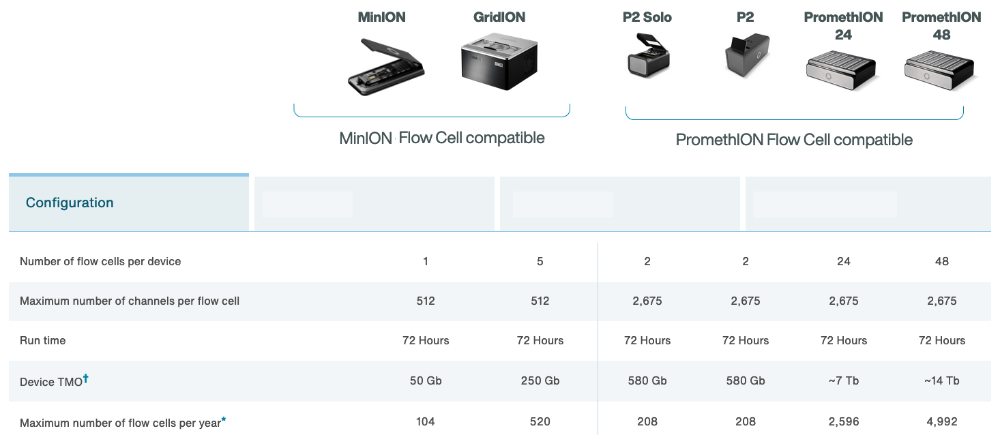
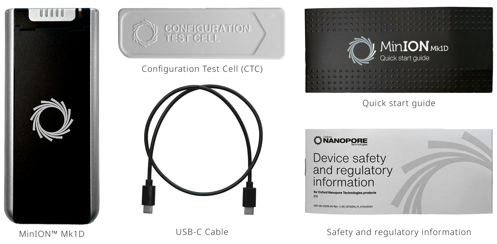
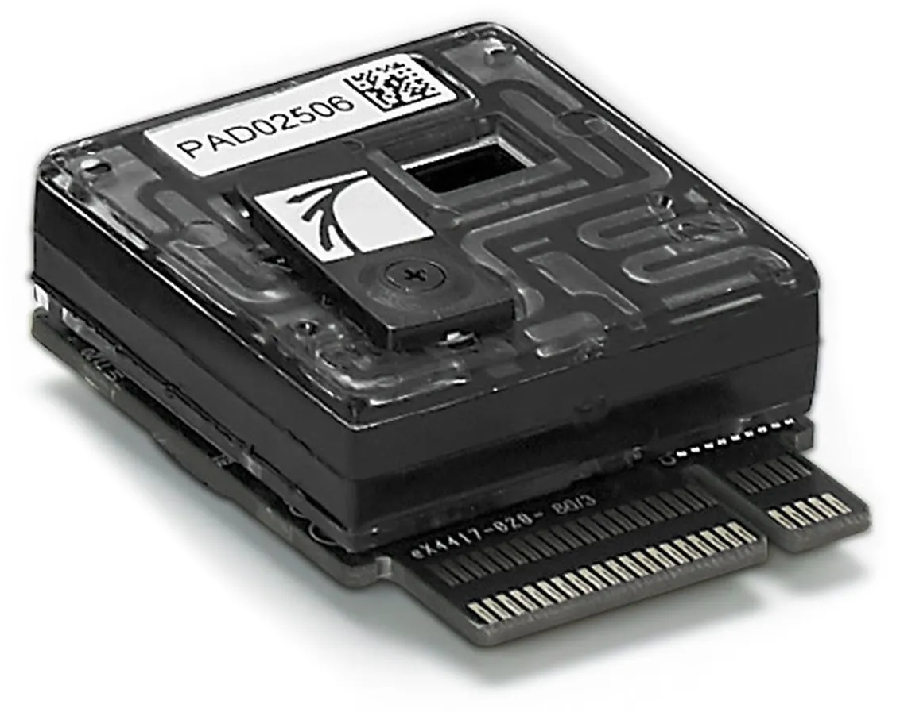
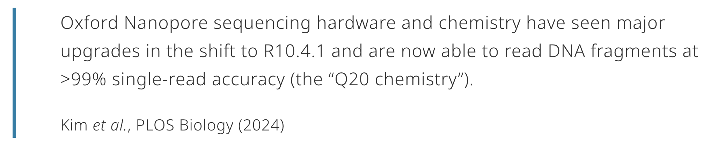
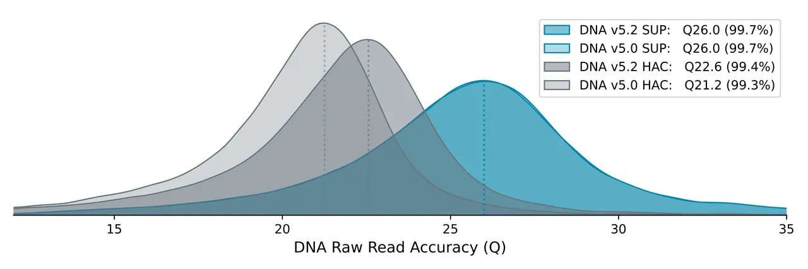

---

title: "Nanopore-based sequencing: introduction"
teaching: 20
exercises: 0
questions:
- "What is nanopore-based sequencing?"
objectives:
- "Understand details of ONT sequencing platforms."
keypoints:
- "ONT produce a range of popular sequencing platforms."
- "This technology is constantly advancing."
source: Rmd

---

```{r, include=FALSE}
library(here)
source("../bin/chunk-options.R")
knitr_fig_path("01-")
knitr::opts_chunk$set(fig.align = "left", echo = FALSE, message = FALSE, warning = FALSE, fig.alt = "", fig.cap = "")
```


### What is this module about?

 - Long-read sequencing with the Oxford Nanopore Technologies (ONT) platform.
 - WHY?
    - recent technology advances have led to a surge in popularly for this platform.
    - Huge scope for really exciting (and low cost) science
    - Concepts and skills learned here are transferable to other sequencing technologies.
 - WHAT?
    - Genome assembly
    - RNA-seq
    - Variant identification (single base & structural)
    - Base modification (e.g., methylation)
    - Metagenomics


### ONT platforms


```{r, out.width="80%"}

```

### The MinION

[http://www.nature.com/news/data-from-pocket-sized-genome-sequencer-unveiled-1.14724](http://www.nature.com/news/data-from-pocket-sized-genome-sequencer-unveiled-1.14724)

 - Original specs (2014)
   - 6-8 hour run time
   - sequence per run: ~110Mbp
   - average read length: 5,400bp
   - reads up to 10kbp
   
 - 2026 specs: 
   - can run for up to 72 hours
   - Maximum (theoretical) yield per run: 50Gbp
   - Maximum read length recorded: >4Mbp

```{r, out.width="50%"}

```

```{r, out.width="50%"}
knitr::include_graphics("../fig/01-nanopore-animation.gif")
```

[https://nanoporetech.com](https://nanoporetech.com)
[https://nanoporetech.com/products/specifications](https://nanoporetech.com/products/specifications)


### The MinION Mk1D

 - The MinION Mk1D is the current version of ONT's original sequencer.
 - Connects to a computer via USB-C.

```{r, out.width="50%"}

```

[https://nanoporetech.com/products/minion](https://nanoporetech.com/products/minion)


<BR><BR><BR><BR>


```{r, out.width="50%"}

```


### MinION flow cells

```{r, out.width="50%"}

```

<BR>

```{r, out.width="50%"}

```


### The GridION

 - The GridION offers a "medium-throughput" option for Nanopore-based sequencing: 
 can run up to five flowcells at once.
 - The MinION and GridION use the same flow cells.


```{r, out.width="50%"}
knitr::include_graphics("../fig/01-gridion.png")
```

[https://nanoporetech.com/products/gridion](https://nanoporetech.com/products/gridion)


### PromethION

 - The higher throughout PromethION uses a smaller cartridge-like flow cell. Two options: 24 or 48 flow cells.

```{r, out.width="50%"}
knitr::include_graphics("../fig/01-promethion48.jpg")
```

[https://nanoporetech.com/products/promethion](https://nanoporetech.com/products/promethion)

<BR>


```{r, out.width="50%"}
knitr::include_graphics("../fig/01-promethion-flowcell.jpg")
```

<BR>

```{r, out.width="50%"}

```


### A "mini-PromethION": the P2

```{r, out.width="70%"}
knitr::include_graphics("../fig/01-p2.png")
```

Smaller device (standalone or connect to host computer) that can run Promethion flow cells.

[https://nanoporetech.com/products/p2](https://nanoporetech.com/products/p2)


### Flowcell characteristics

 - Pores are arranged in sets of four to form a “channel”. Periodically during the sequencing run, the ONT 
 software decides which of the four pores to use from each channel (called a “mux scan”).
   - MinION flowcells have 512 channels, so 2048 pores: typically ~1200-1800 are "active" (usable pre-run) 
   (ONT guarantees at least 800 active pores).
   - PromethION flowcells have 2675 channels, so 10,700 pores (ONT guarantees at least 5000 active pores).
 - Sequencing occurs at roughly 450 bases per second (ONT recommends keeping speed above 300 bases per second - 
 additional reagents can be added to "refuel" the flowcell*), although other speeds are now possible 
 (can prioritise data volume vs accuracy).
 - NOTE: pores are not constantly active, and can become blocked during the run 
 
 * [https://community.nanoporetech.com/protocols/experiment-companion-minknow/v/mke_1013_v1_revbm_11apr2016/refuelling-your-flow-cell](https://community.nanoporetech.com/protocols/experiment-companion-minknow/v/mke_1013_v1_revbm_11apr2016/refuelling-your-flow-cell)


### Nanopore technology


```{r, out.width="70%"}
knitr::include_graphics("../fig/01-nanopore.png")
```

[https://nanoporetech.com/how-it-works](https://nanoporetech.com/how-it-works)


### Nanopore technology

 - A motor protein (green) passes a strand of DNA through a nanopore (blue). The current is changed as the bases G, A, T and C pass through the pore in different combinations.

```{r, out.width="60%"}
knitr::include_graphics("../fig/01-sequencing-animated_0.gif")
```

[https://nanoporetech.com/how-it-works](https://nanoporetech.com/how-it-works)


### More information

For more detailed information about ONT sequencing:

 - [https://nanoporetech.com/products/minion](https://nanoporetech.com/products/minion)
 - [https://nanoporetech.com/resources](https://nanoporetech.com/resources)


### Technological advances...

 - Since its introduction, nanopore sequencing has seen a number of improvements.
 - The initial product was realtively slow, expensive (per base sequenced) and error prone (i.e., incorrect bases calls).
 - Incremental improvements have led to major advances in both speed and accuracy.

```{r, out.width="80%"}
knitr::include_graphics("../fig/01-ont-screening.png")
```

[https://nanoporetech.com/resource-centre/london-calling-2022-update-oxford-nanopore-technologies](https://nanoporetech.com/resource-centre/london-calling-2022-update-oxford-nanopore-technologies)

 


### Pore imporvements: the R10 pore

 - ONT introduced the new R10 pore in 2019 (previous was R9.4.1).
 - Main differences were *longer barrel* and *dual reader head:* gave improved resolution of homopolymer runs.


```{r, out.width="50%"}
knitr::include_graphics("../fig/01-r10-pore.png")
```

[https://nanoporetech.com/about-us/news/r103-newest-nanopore-high-accuracy-nanopore-sequencing-now-available-store](https://nanoporetech.com/about-us/news/r103-newest-nanopore-high-accuracy-nanopore-sequencing-now-available-store)


### Nanopore workflow

```{r, out.width="70%"}
knitr::include_graphics("../fig/01-nanopore-workflow.png")
```

 - ONT provides software (MinKNOW) for operating the MinION, and for generating the sequence data (e.g., the `guppy` and `dorado` basecallers).
 - Once the raw (POD5 or FAST5 - see next section) data have been converted to basecalls, we can use more familiar tools for quality assessment and analysis (e.g., FastQC).

[https://nanoporetech.com/nanopore-sequencing-data-analysis](https://nanoporetech.com/nanopore-sequencing-data-analysis)


### Basecalling: `dorado`

 - ONT base caller: `dorado`
 - Optimised for 10.4.1 flowcells 
 - Designed to support Apple Silicon GPUs
 - Can call base modifications:
   - DNA: 5mC, 5hmC, 4mC, 6mA
   - RNA: m5c. m6a, inosine, pseU 2-mecC. 20meA, 20meG, 20meU
 - Also has FAST, HAC and SUP modes for basecalling.

### 10.4.1 flowcells + v14 chemistry: accuracy

```{r, out.width="50%"}

```

<BR> 

```{r, out.width="50%"}

```

<BR> 

```{r, out.width="50%"}

```

[https://nanoporetech.com/accuracy](https://nanoporetech.com/accuracy)

### OLDER INFORMATION

#### 10.4.1 flowcells + v14 chemistry: simplex

- The v14 chemistry and 10.4.1 flowcells achieved quality scores of ON AVERAGE 1 error per 100 bases (Q20) for simplex reads (single strand).

```{r, out.width="50%"}
knitr::include_graphics("../fig/01-ont-simplex-q20.png")
```


#### 10.4.1 flowcells + v14 chemistry: duplex

- "Duplex mode" involves reading both strands of a fragment, and using the dual 
information for error correction.
- This achieves higher quality for duplex reads: mean of 30
- BUT: less than 50% of reads are duplex (i.e., you don't always manage to read both strands)

```{r, out.width="50%"}
knitr::include_graphics("../fig/01-ont-duplex-q30.png")
```


### More Nanopore: London Calling 2026


```{r, out.width="50%"}


```

 - Conference held in May 2026
 - Talk videos available online
 - LOTS of really cool announcements and research applications
 - Can also watch presentations from previous years:

[https://www.youtube.com/playlist?list=PLxpxXZj-IgXyh79ddDNm7mM0W0jFtKPnr](https://www.youtube.com/playlist?list=PLxpxXZj-IgXyh79ddDNm7mM0W0jFtKPnr)


